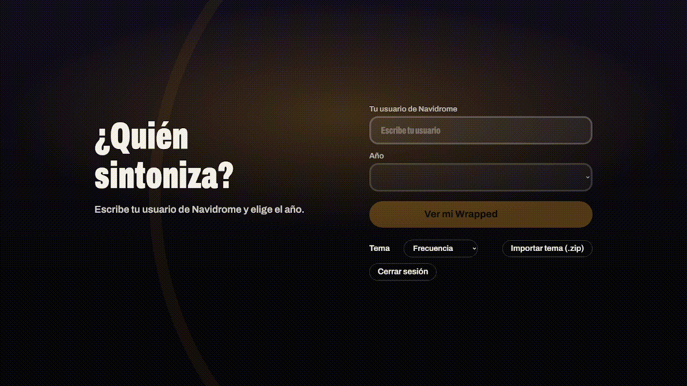
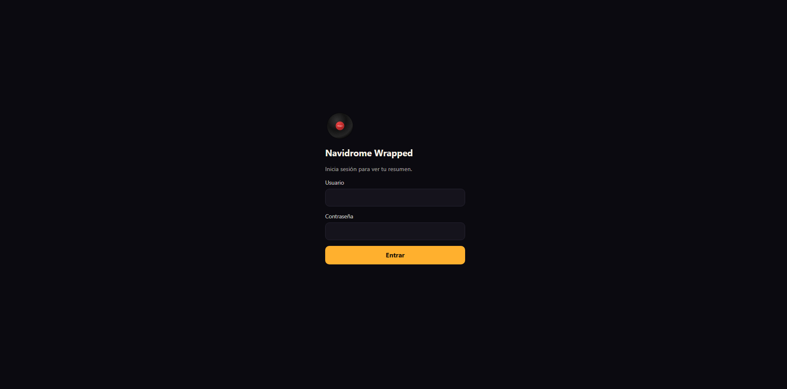

[English 🇬🇧](README.md) | [Deutsch 🇩🇪](README.de.md) | [Español 🇪🇸](README.es.md) | [Português 🇵🇹](README.pt.md) | [Français 🇫🇷](README.fr.md) | [Русский 🇷🇺](README.ru.md) | [中文 🇨🇳](README.zh.md) | [日本語 🇯🇵](README.ja.md) | [한국어 🇰🇷](README.ko.md) | [العربية 🇸🇦](README.ar.md)

> **Примечание о переводе:** Переводы проекта выполнены с помощью ИИ и могут содержать ошибки.

# Navidrome Wrapped

Годовой обзор Navidrome в стиле Wrapped: любимые исполнители и треки, минуты прослушивания, открытия и статистика ночных прослушиваний, повторов и любимого времени. История сопровождается музыкой, а каждую карточку можно сохранить в PNG.

- **Сервер:** FastAPI, SQLite только для чтения и ffmpeg для аудиофрагментов.
- **Интерфейс:** HTML/CSS/JavaScript и Swiper; сборка и CDN не требуются.
- **Темы:** внешний вид, текст и порядок слайдов настраиваются темами. См. [THEMES.md](THEMES.md).
- **Языки:** английский, немецкий, испанский, русский, китайский, японский, корейский и арабский.
- **Доступность:** пауза с клавиатуры, видимый фокус и объявления слайдов для программ чтения с экрана. Формальная проверка и соответствие WCAG не подтверждены.

## Демонстрация



Необязательный экран входа включается параметрами `AUTH_USER` и `AUTH_PASSWORD`:



## Развертывание

Приложение работает в контейнере Linux. Для 64-разрядной Windows нужны Docker Desktop и WSL 2. Нативной версии Windows и поддержки 32-разрядной Windows нет.

```bash
cp .env.example .env
./deploy.sh
# → http://IP-СЕРВЕРА:8100/
```

Основные параметры `.env`:

| Переменная | Значение |
|---|---|
| `NAVIDROME_NETWORK` | Сеть Docker для Navidrome |
| `NAVIDROME_DATA_DIR` | Каталог хоста с `navidrome.db` |
| `MUSIC_DIR_HOST` | Каталог хоста с музыкой |
| `WRAPPED_LANGUAGE` | `en` (по умолчанию), `de`, `es`, `pt`, `fr`, `ru`, `zh`, `ja`, `ko` или `ar` |
| `ADMIN_KEY` | Ключ для импорта ZIP-тем |
| `PUID` / `PGID` | Идентификаторы пользователя и группы с доступом на чтение |

Музыка внутри контейнера должна находиться по тому же пути, что и в Navidrome (обычно `/music`). После смены `WRAPPED_LANGUAGE` запустите `./deploy.sh` повторно. Для пользовательских тем нужны собственные переводы. Каждый посетитель также может выбрать язык в правом верхнем углу; выбор сохранится в его браузере и не изменит язык сервера по умолчанию.

## Использование и безопасность

На стартовом экране укажите имя пользователя Navidrome и год. Переведите фокус на область истории и используйте ←/→ для навигации. Пауза доступна кнопкой или клавишей `P`. Учитывается настройка системы для уменьшения анимации.

По умолчанию вход не включён. Если приложение доступно извне домашней сети, используйте HTTPS и обратный прокси с авторизацией. Темы могут выполнять JavaScript в браузере — импортируйте только доверенные файлы.

## API и разработка

Основные маршруты: `/api/health`, `/api/config`, `/api/years?user=`, `/api/wrapped?user=&year=`, `/api/themes` и `/api/themes/{id}`. Подробности о темах и локальном демо доступны в [английском README](README.md) и [THEMES.md](THEMES.md).
